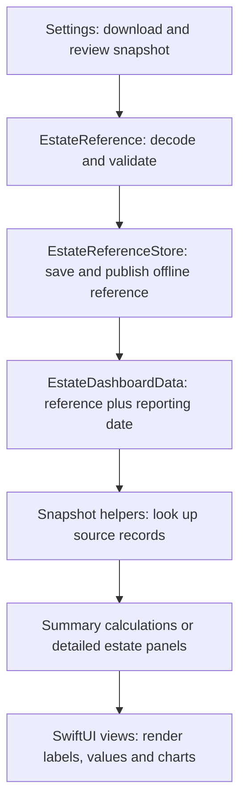

# Understanding and adapting the iOS app

Start with [build and setup instructions](README.md). This guide explains where to read and change the dashboard code when using this app as a starting point.

This is an estate information app with domain-specific records and calculations. The separation below makes those decisions easier to replace; it does not turn the project into a generic app framework.

## Follow one value from download to screen

The store restores the saved reference at startup. Views observe it and pass a date into `EstateDashboardData`; the calculation model does not download or save records. A `TimelineView` refreshes dashboard presentation periodically so date-dependent results can change without a new download. This does not perform background synchronization.

For example, actual YTD yield follows this path:

1. The JSON `yph` object is decoded into `EstateReference.yph`.
2. `summaryValues` checks the reporting year, source month, mature area and actual tonnage.
3. It calculates actual YTD tonnes divided by mature hectares.
4. `operationalCards` puts the formatted value into the Crop Production rows.
5. Phone and iPad views render those rows. Missing or unusable inputs display Pending; measured zero stays zero.

## File responsibilities

| File | Read or change it for |
| --- | --- |
| [Selendang3App.swift](Selendang3/Selendang3App.swift) and [HomeView.swift](Selendang3/HomeView.swift) | App entry point and main navigation |
| [EstateReference.swift](Selendang3/EstateReference.swift) | Snapshot types, parsing and endpoint validation |
| [EstateReferenceStore.swift](Selendang3/EstateReferenceStore.swift) | Downloading, revision checks, local persistence and observed state |
| [EstateDashboardData+Snapshot.swift](Selendang3/EstateDashboardData+Snapshot.swift) | Table/column lookup, numeric conversion, duplicate overview rows and field records |
| [EstateDashboardData+Summaries.swift](Selendang3/EstateDashboardData+Summaries.swift) | Reporting calendar, report eligibility and shared summary calculations |
| [EstateDashboardData.swift](Selendang3/EstateDashboardData.swift) | Panel/bar models, detailed estate panels and field-table projections |
| [HomeDashboardSummaryView.swift](Selendang3/HomeDashboardSummaryView.swift) | Phone operational cards and iPad dashboard layout |
| [EstateDashboardView.swift](Selendang3/EstateDashboardView.swift) | Detailed estate panels and charts |
| [CropProductionTableData.swift](Selendang3/CropProductionTableData.swift) | Field production table and field-summary calculations |
| [EstateTheme.swift](Selendang3/EstateTheme.swift) | Shared appearance, colours and screen styling |

The `+Snapshot` and `+Summaries` names are Swift extensions: they add methods to the same `EstateDashboardData` type while keeping related responsibilities in separate files. A calculation can access `reference` and `today` without creating a second store.

## Two presentations, shared summary rules

`summaryValues` supplies YPH, annual-budget achievement, current-year costs and month labels. It is recalculated from the model's inputs; there is no separate summary cache to synchronize.

- `operationalCards` supplies the current phone dashboard and iPad dashboard card. The Upkeep view also reads its Manuring card.
- `homeRows` is a retained compact text presentation, covered by tests. Current SwiftUI screens do not call it. It uses the same summary values to keep its output consistent.
- `panels` supplies Estate Details. Detailed YPH and cost panels retain their source reporting periods, including historical years, while current summaries reject stale or future periods. Keep this distinction when changing freshness rules.

## Where to make a change

**Change a label, spacing or colour:** start with the owning SwiftUI view or `EstateTheme`. Change panel labels in the calculation model when those labels are part of its output. Keep source column names separate from display labels; column names are part of the snapshot contract.

**Change a summary formula:** edit `summaryValues` or its report helpers. For example, changing the annual-budget achievement rule there updates both summary presentations. Keep `today` injected rather than reading `Date()` inside a calculation so boundary cases remain testable.

**Add a dashboard metric:** identify its source snapshot field first, extend decoding if needed, add its eligibility/calculation rule, and expose its value in the appropriate panel. Then update the phone and iPad layouts and add expected-output checks. The current views use positional card and row indexes such as `cards[3]` for Manuring. Preserve that order or update every consumer together; simply inserting a card can display the wrong metric or cause an index error.

**Adapt the app to another estate or domain:** review the hardcoded estate ID and API paths in `EstateReference.swift`, labels and source columns, formulas and units, and the reporting timezone in `reportCalendar`. Update the server and Android contract together if those clients remain part of your fork. Update the bundle identifier in [project.yml](project.yml), app name, artwork and bundled map for your own app. Start with fictional records, such as the [sample snapshot](../sample-data/estate-update.example.json), while learning the data flow; the basic sample does not populate every dashboard extension.

Legacy production draft/store code remains in the repository, but current operational screens read VPS snapshots. Read [current operation](README.md#server-only-operation-build-33) before deciding which path your fork needs.

## Verify a change

[DashboardSummaryChecks.swift](Tests/DashboardSummaryChecks.swift) checks summary values and labels against fixed expectations, including zero, missing values, future/stale periods, month ends and Kuala Lumpur New Year. [EstateDashboardChecks.swift](Tests/EstateDashboardChecks.swift) covers detailed panels, field calculations and report behavior. Parser checks live in [EstateReferenceChecks.swift](Tests/EstateReferenceChecks.swift).

The [iOS CI workflow](../.github/workflows/ios.yml) shows the complete standalone Swift commands and builds the app for the simulator. When adding another calculation source file, include it in the relevant standalone commands; [XcodeGen](project.yml) already includes source files beneath `Selendang3/` for the app build. See [setup](README.md#build-and-validation) for local project generation and signing.
